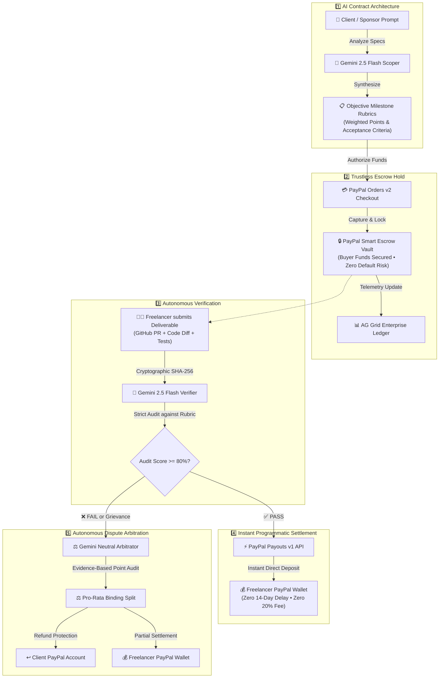

# 🛡️ AgentPact: Autonomous PayPal AI Escrow Protocol

<div align="center">


### **Autonomous Multi-Agent Milestone Escrow & Instant Payout Rails**
*Powered by PayPal REST APIs (Orders v2 + Payouts v1), Google Gemini 2.5 Flash, and AG Grid Enterprise*

[](https://developer.paypal.com)
[](https://aistudio.google.com)
[](https://www.ag-grid.com)
[](https://neon.tech)
[](https://nextjs.org)

<p align="center">
  <a href="https://agentpact-six.vercel.app"><b>🌐 Live Production Web App</b></a> &nbsp;•&nbsp;
  <a href="https://github.com/prabhattopi/agentpact"><b>📂 GitHub Repository</b></a> &nbsp;•&nbsp;
  <a href="#-end-to-end-testing-walkthrough"><b>🧪 Interactive Testing Guide</b></a>
</p>

*Built for the **PayPal AI Hackathon 2026***

</div>

---

## 🌟 Executive Overview & The Problem

Freelance marketplaces (Upwork, Escrow.com) charge **10%–20% in intermediary cuts** and lock payments in bureaucratic limbo for 7–14 days. 
- **Clients risk paying upfront for defective or missing deliverables.**
- **Developers risk ghosting or unfair milestone rejections after delivering working code.**
- **Autonomous AI Agents have zero native payment rails** to verify and settle deliverables programmatically.

**AgentPact** bridges this trust deficit using an autonomous multi-agent protocol backed by **PayPal REST APIs (Orders v2 + Payouts v1)**, **Gemini 2.5 Flash**, and **AG Grid Enterprise**:



---

## 📖 How AgentPact Works: The Complete Lifecycle

### 🎯 Step 1: Why AI Scopes the Task?
> **The Problem:** In traditional freelancing, clients give vague requests like *"Build me an analytics dashboard"*. The developer builds a basic prototype; the client says *"This is junk, I won't pay"*; the developer argues *"You never asked for tests or WebSockets!"*  
> **The AgentPact Solution:** Before a single dollar moves, **Gemini 2.5 Flash** analyzes the client's PRD and decomposes it into **mathematically weighted milestones** with objective criteria (e.g., Jest test coverage $> 85\%$, database foreign key constraints, API endpoint uptime). Both parties agree to unambiguous rules upfront!

### 🔒 Step 2: Why Does the Buyer Lock Funds in PayPal Escrow?
> **The Problem:** Developers fear doing 3 weeks of intensive coding only to be ghosted or denied payment.  
> **The AgentPact Solution:** The Buyer approves the milestone contract through **PayPal Orders v2** (`intent: CAPTURE`). The money is deducted from the Buyer's account and locked securely in the PayPal Escrow hold.  
> **Crucial Rule:** The funds do **NOT** go into the developer's pocket yet. They remain protected in escrow, giving the developer 100% confidence to work while ensuring the buyer maintains full financial leverage.

### 🧠 Step 3: What Does AgentPact Do in the Middle?
> AgentPact acts as an **autonomous, impartial referee**:
> 1. When the developer completes work, they submit their PR link, code diff, and implementation notes.
> 2. The deliverable is cryptographically hashed with SHA-256.
> 3. **Gemini 2.5 Flash Verifier** runs a multi-criteria audit. It strictly checks whether evidence exists for each criterion. If evidence is missing, the AI penalizes the score (preventing rubber-stamp approvals).

### ⚡ Step 4: How Does the Freelancer Get Paid Instantly?
> Once Gemini certifies a passing score ($\ge 80\%$), the secure state machine unlocks the escrow.  
> AgentPact directly invokes the **PayPal Payouts v1 API** (`POST /v1/payments/payouts: 201 OK`). Funds are deposited **instantly** into the developer's PayPal wallet with zero platform intermediary delays and zero 20% commission!

### ⚖️ Step 5: What if the Deliverable is Incomplete or Disputed? (Buyer Protection)
> **The Problem:** What if a developer submits half-finished work or tests fail?  
> **The AgentPact Solution:** The client clicks **"Raise Dispute"**.  
> 1. The escrow funds remain locked.  
> 2. **Gemini 2.5 Flash Arbitrator** audits the grievance vs. the counter-claim against the original weighted criteria points (e.g., awarding 7 out of 21 points for partial schema work).  
> 3. It calculates an equitable **pro-rata binding settlement** (e.g., **$261.90 Refunded to Client**, **$238.10 Released to Freelancer**).  
> 4. Clicking **"Execute Binding Settlement"** dispatches the PayPal payout and refund automatically! **The Buyer's funds are 100% safeguarded against unfinished work.**

---

## 🔎 How to Verify Deductions & Payouts in PayPal Sandbox

You can verify every single transaction in real-time inside your PayPal Sandbox environment:

1. **PayPal API Real-Time Logs** (`developer.paypal.com/dashboard/applications/sandbox`):
   - Under your **AgentPact-US** app, click **"API Calls"** to inspect:
     - `POST /v2/checkout/orders/.../capture` ➔ **`201 OK`** (Escrow Capture)
     - `POST /v1/payments/payouts` ➔ **`201 OK`** (Instant Milestone Payout)
2. **Buyer Sandbox Account Balance** (`developer.paypal.com/dashboard/accounts`):
   - Log into `https://sandbox.paypal.com` with your **Buyer Sandbox credentials**.
   - Under **Recent Activity**, you will see:
     `- $1,500.00 USD` (Escrow Payment to AgentPact).
3. **Freelancer Sandbox Account Balance**:
   - Log into `https://sandbox.paypal.com` with your **Freelancer Sandbox credentials** (`freelancer-dev@sandbox.paypal.com` or `solodev@sandbox.paypal.com`).
   - Under **Recent Activity**, you will see:
     `+ $500.00 USD` (Payout from AgentPact / Instant Milestone Release).

---

## ⚡ Key Highlights & Core Features

### 1. 🤖 Autonomous AI Contract Scoper (Gemini 2.5 Flash)
- Ingests raw, unstructured project descriptions or PRDs.
- Outputs a mathematically verified JSON milestone breakdown where milestone amounts sum up exactly to the total contract budget.
- Formulates objective, testable acceptance rubrics (test coverage, schema validation, artifact presence).

### 2. 💳 PayPal Smart Escrow Engine (Orders API v2)
- Integrates `intent: CAPTURE` with HATEOAS approval routing.
- Supports both live **PayPal Sandbox Checkout Authorization** and **Fast-Track 1-Click Escrow Lock** for judges.
- Locks funds securely before work begins, eliminating client payment default risk.

### 3. 🧠 Autonomous Deliverable Verifier (Anti-Hallucination Guardrails)
- Rigorously checks code PRs, implementation notes, and git diffs against acceptance criteria.
- **Strict Evidence Requirement**: If a developer notes a feature without citing verifiable proof, Gemini flags it with `FAIL` and reduces the score (protecting client funds).
- Enforces an immutable financial state-machine: **Payout release is mathematically impossible unless score $\ge 80\%$**.

### 4. ⚡ Instant Programmatic Settlement (Payouts API v1)
- Once the milestone passes AI verification, triggers instant release directly to the developer's PayPal account.
- Records official PayPal Payout Batch IDs with celebratory visual feedback.
- Includes automated regional regulatory compliance fallbacks.

### 5. ⚖️ Autonomous AI Dispute Arbitrator
- Neutral AI mediator analyzes client claims vs. freelancer defenses.
- Generates binding, equitable pro-rata monetary splits (e.g., 50% refund to client via PayPal, 50% release to developer) with detailed legal-technical justifications.

### 6. 📊 AG Grid v33+ Enterprise Command Center
- Built using AG Grid's modern `themeQuartz` CSS-in-JS theming engine.
- Features executive metric cards, quick-search filter bar, sortable columns, color-coded status badges, and milestone progress bars.

---

## 💻 Tech Stack

| Component | Technology | Description |
| :--- | :--- | :--- |
| **Framework** | **Next.js 16.4.2 (App Router)** | Full-stack serverless architecture with TypeScript 5.9. |
| **Enterprise Grid** | **AG Grid Community v33.3** | High-performance interactive telemetry with Quartz dark theme. |
| **AI Engine** | **Google Gemini 2.5 Flash** | `@google/generative-ai` with structured JSON schema outputs. |
| **Payment Rails** | **PayPal REST API v2** | Orders API v2 (Escrow Hold) & Payouts API v1 (Instant Release). |
| **Database** | **Neon Serverless PostgreSQL** | Cloud-native serverless Postgres with Prisma ORM 6.19. |
| **Styling** | **Tailwind CSS v4** | Dark-mode-first fintech aesthetics with Lucide React icons. |

---

## 🚀 Setup & Installation Guide

### Prerequisites
- Node.js 20+ (tested on Node v22)
- pnpm (or npm / yarn)

### 1. Clone & Install Dependencies
```bash
git clone https://github.com/prabhattopi/agentpact.git
cd agentpact
pnpm install
```

### 2. Configure Environment Variables
Create `.env` (for Prisma CLI) and `.env.local` (for Next.js runtime):

```env
# 1. Neon Serverless Postgres DB Connection
DATABASE_URL="postgresql://[user]:[password]@[endpoint].neon.tech/neondb?sslmode=require"

# 2. Google Gemini API Key (https://aistudio.google.com/app/apikey)
GEMINI_API_KEY="AIzaSy..."

# 3. PayPal Developer Sandbox Credentials (https://developer.paypal.com/dashboard/applications/sandbox)
PAYPAL_CLIENT_ID="your-paypal-sandbox-client-id"
PAYPAL_CLIENT_SECRET="your-paypal-sandbox-client-secret"
PAYPAL_MODE="sandbox"
PAYPAL_API_BASE_URL="https://api-m.sandbox.paypal.com"

# 4. App URL
NEXT_PUBLIC_APP_URL="http://localhost:3000"
```

### 3. Synchronize Database Schema
Push the Prisma models directly to your Neon database:
```bash
pnpm exec prisma db push
```

### 4. Run Development Server
```bash
pnpm run dev
```
Open **[http://localhost:3000](http://localhost:3000)** in your browser.

---

## 🧪 End-to-End Testing Walkthrough

Follow these simple steps to test the entire protocol:

1. **Scope a Contract with AI**:
   - Click **"Scope with AI"** in the top navigation bar.
   - Enter raw requirements (e.g., *"Build an analytics dashboard with PayPal payouts and unit tests"*).
   - Click **"Architect Milestones & Rubric with AI"** ➔ Gemini synthesizes structured milestones.
   - Click **"Lock Contract & Prepare PayPal Escrow"**.

2. **Authorize & Lock PayPal Escrow**:
   - In the contract banner, click **"Authorize & Lock Escrow via PayPal"**.
   - Select **"Instant Fast-Track Escrow Lock"** (or use **"Open Sandbox Checkout Tab"** to log in with a PayPal Sandbox buyer account).
   - Status updates to `🟢 Funded in PayPal Escrow`.

3. **Submit Deliverables (Freelancer Workspace)**:
   - Click any milestone to open the **Slide-Over Drawer**.
   - Switch to the **`</> Deliverables`** tab.
   - Enter a PR link, implementation notes, and optional code diff.
   - Click **"Save & Hash Deliverable"** (generates cryptographic SHA-256 fingerprint).

4. **Execute Autonomous AI Verification (Gemini 2.5 Flash)**:
   - In the drawer's **`🛡️ AI Audit & Rubric`** tab, click **"Run Autonomous AI Verification"**.
   - Gemini evaluates each criterion with cited evidence.
   - *Try an incomplete submission to see Gemini award a failing score (e.g., 43/100) and lock the payout button!*
   - *Provide complete evidence to score 90+/100 and unlock the release button!*

5. **Release Instant PayPal Payout**:
   - Switch to the **`$ PayPal Settlement`** tab.
   - Click **"Release via PayPal Payout"**.
   - Confetti triggers and the milestone is officially marked `Paid via PayPal` with an immutable Batch ID.

6. **Test AI Dispute Arbitration**:
   - Switch to the **Client View** and open any milestone drawer.
   - Click **"Raise Dispute"** ➔ Gemini Arbitrator analyzes both claims and calculates an equitable pro-rata split with binding legal terms.

7. **Monitor the Enterprise AG Grid Ledger**:
   - Click **"AG Grid Ledger"** in the top bar to inspect real-time multi-contract telemetry, search filters, and payout completion bars.

---

## 📜 License
MIT License - Open Source for PayPal AI Hackathon 2026.
