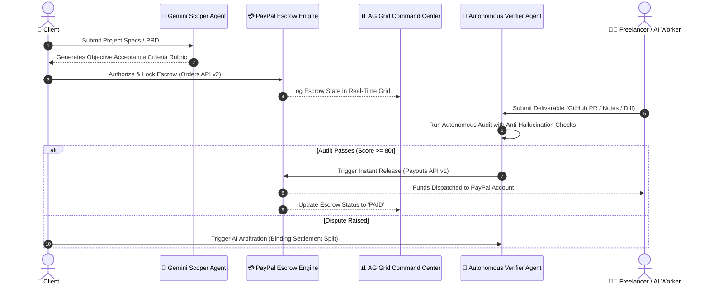

# 🛡️ AgentPact: Autonomous AI Milestone Escrow & Payout Protocol

> **Built for the PayPal AI Hackathon 2026**  
> *Track Targets: Best Use of Agentic Commerce ($5,000) • Best Use of AG Grid ($5,000) • Best Use of PayPal + AI ($5,000) • Overall Grand Prize ($12,000)*

---

## 💡 The Real-World Problem Being Solved

Freelance marketplaces (Upwork, Escrow.com) charge **10%–20% in intermediary fees** and hold funds in bureaucratic purgatory for 7–14 days. Meanwhile:
- **Clients risk paying for non-functional or fake deliverables.**
- **Developers risk ghosting or unfair milestone rejections after submitting working code.**
- **Autonomous AI Agents have zero native payment rails** to verify and settle deliverables programmatically.

**AgentPact** bridges this trust deficit using an autonomous multi-agent protocol backed by **PayPal REST APIs (Orders v2 + Payouts v1)** and **Gemini 2.5 Flash**:
1. **AI Contract Scoper**: Breaks raw requirements into objective, weighted acceptance criteria.
2. **PayPal Smart Escrow**: Authorizes and locks contract funds into PayPal sandbox escrow.
3. **Autonomous Deliverable Verifier**: Impartially audits GitHub PRs, commits, and tests against criteria rubrics.
4. **PayPal Instant Settlement**: Automatically dispatches programmatic payouts directly to the developer's PayPal account upon verified delivery.
5. **AI Arbitrator**: Impartially mediates disputes with binding pro-rata splits.
6. **AG Grid Executive Command Center**: Real-time interactive telemetry tracking escrow balances, milestone completions, and audit logs.

---

## 🏗️ Architecture & Security Guardrails



### 🔒 Enterprise Safety & Anti-Tamper Guardrails
- **Prompt-Injection Sanitization**: All user/deliverable inputs are scrubbed of override sequences (`ignore all previous instructions`, system prompt injections).
- **Cryptographic Deliverable Hashes**: Deliverables are fingerprinted using SHA-256 before verification.
- **Financial State Machine Enforcement**: Agents **cannot** trigger arbitrary PayPal calls without meeting strict prerequisites (`ESCROW_LOCKED`, `SUBMITTED`, `overallScore >= 80`, and `antiHallucinationScore >= 0.7`).
- **Zero-Hallucination Evidence Matching**: Verifier requires verifiable quotes/code proof before marking any criterion satisfied.

---

## 🚀 Quickstart & Setup

### Prerequisites
- Node.js 18+ (tested on Node v22)
- pnpm (or npm / yarn)

### 1. Installation
```bash
cd agentpact
pnpm install
```

### 2. Environment Configuration
Copy `.env.example` to `.env.local`:
```bash
cp .env.example .env.local
```

Fill in your credentials (or test with the pre-configured graceful simulation fallbacks):
```env
# Neon Serverless Postgres DB
DATABASE_URL="postgresql://[user]:[password]@[endpoint].neon.tech/[dbname]?sslmode=require"

# Google Gemini API Key (https://aistudio.google.com/app/apikey)
GEMINI_API_KEY="your-gemini-api-key"

# PayPal Developer Sandbox (https://developer.paypal.com/dashboard/applications/sandbox)
PAYPAL_CLIENT_ID="your-paypal-sandbox-client-id"
PAYPAL_CLIENT_SECRET="your-paypal-sandbox-client-secret"
PAYPAL_MODE="sandbox"
```

### 3. Run Development Server
```bash
pnpm run dev
```
Open [http://localhost:3000](http://localhost:3000) to view the application.

---

## 🌟 Interactive Features to Test

1. **Split-Screen Dual Perspective**: Switch between **Client View**, **Freelancer View**, **AG Grid Ledger**, or **Dual Screen** using the top navigation bar.
2. **AI Contract Scoper**: Click **"Scope with AI"** to turn any prompt into structured milestones with weighted criteria.
3. **PayPal Escrow Funding**: Click **"Authorize & Lock Escrow via PayPal"** to simulate dynamic order creation and escrow capture.
4. **Milestone Deliverable Submission**: Paste a GitHub PR URL and notes as Freelancer.
5. **Gemini 2.5 Flash Autonomous Audit**: Click **"Run Autonomous AI Verification"** to generate real-time evidence evaluation.
6. **Programmatic PayPal Payout**: Click **"Claim via PayPal Payout"** to execute instant release.
7. **Autonomous Dispute Arbitration**: Click **"Raise Dispute"** to witness neutral compromise mediation with automated split payouts.
8. **AG Grid Enterprise Ledger**: Inspect real-time multi-contract telemetry with sorting, filtering, and milestone progress bars.

---

## 📜 License
MIT License - Open Source for PayPal AI Hackathon 2026.
